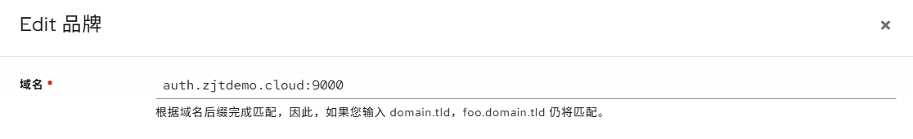
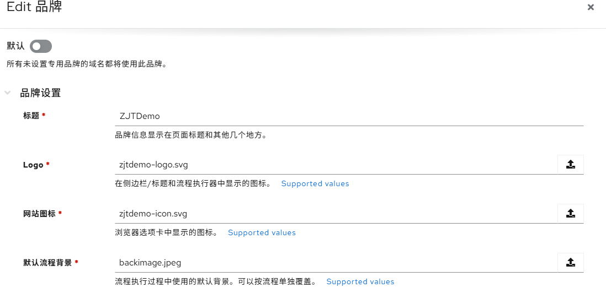
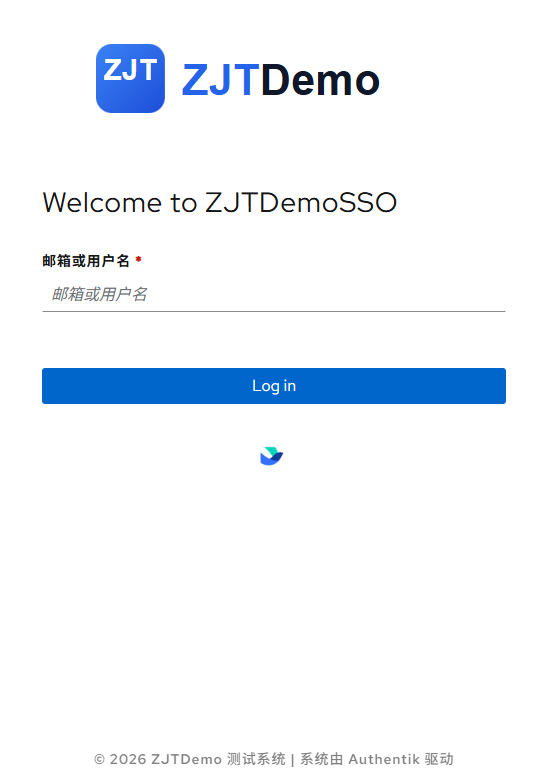

## 概述

authentik 登录页底部默认会显示一组站点链接（Help、Terms 等）。如果这些链接对内部系统没有意义，可以通过创建 Brand（品牌）并注入自定义 CSS，把它们替换成一行版权/系统说明文字。

## 一、创建品牌

进入 **Customization → Brands → Create**，填写名称并绑定默认的「default」Domain，保存后把它设为默认品牌。品牌创建后即可在该品牌下编辑自定义 CSS。





## 二、自定义 CSS

在品牌的 Custom CSS 中填入：

```css
/* 隐藏默认的站点链接列表 */
ak-brand-links::part(list),
ak-brand-links ul[aria-label="Site links"] {
  display: none !important;
}

/* 用一行版权信息替代 */
ak-brand-links::after {
  display: flex;
  justify-content: center;
  align-items: center;
  width: 100%;
  margin-top: 10px;
  content: "© 2026 ZJTDemo 测试系统 | 系统由 Authentik 驱动";
  font-size: 14px;
  font-weight: 500;
  color: rgba(0, 0, 0, 0.5);
  font-family: inherit;
}
```

说明：

- `ak-brand-links` 是 Web Components 自定义元素，链接列表位于其 shadow DOM 中，因此需要用 `::part(list)` 才能命中并隐藏。
- `::after` 伪元素在容器内生成新的版权文字，`flex` 布局保证水平居中。
- 版权文字中的 `|` 为普通字符，实际 CSS 中无需转义。
- 主题为深色时，可把 `color` 调整为浅色，例如 `rgba(255, 255, 255, 0.6)`。

保存后刷新登录页即可看到效果。



## 三、验证

- 用无痕窗口打开登录页，确认默认链接已消失、版权文字居中显示。
- 在移动端窄屏下检查文字是否换行正常。
- 若品牌未生效，检查 Domain 绑定是否正确、品牌是否已设为默认。

---

> 本文由 WorkBuddy AI 编辑整理。
