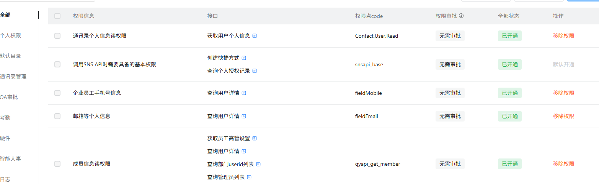

## 概述

为 Authentik 添加钉钉作为第三方登录源（OAuth Source），用户可直接使用钉钉扫码/账号登录。由于钉钉开发者平台没有提供标准的OAuth连接协议，authentik无法使用通用OAuth Source来直接对接钉钉。通过Workbuddy来创建钉钉的Souce模板，整个过程通过 Web 向导即可完成，只需填写应用的 AppKey 与 AppSecret。

## 一、钉钉开放平台侧准备

1. 登录钉钉开发者平台，创建企业内部应用（或第三方应用）。
2. 在应用的「安全设置」中获取 **AppKey**（Client ID）和 **AppSecret**（Client Secret）。
3. 设置回调域名为 authentik 的访问地址，例如 `auth.zjtdemo.cloud`，并在重定向 URL 中填入 authentik 生成的回调地址，格式为：

   ```
   https://<authentik 域名>/source/oauth/callback/<slug>/
   ```

   其中 `<slug>` 与下一步在 authentik 中创建的 Source slug 必须完全一致。

> 注意：AppSecret 属于敏感凭据，不要提交到版本库或公开渠道。

在这个钉钉开发者平台中，配置应用权限，确认已授权以下权限：
 

## 二、在 Authentik 添加钉钉源

下载本文中的附件，将附件解压在authentik docker compose 工作目录，执行deploy.sh 脚本，按照以下顺序进行部署，即可附加企业微信和钉钉模板。
> 注意：每次更新authentik版本后，需要重新部署附加企业微信和钉钉模板。
```
./deploy.sh check
./deploy.sh prepare
./deploy.sh config
./deploy.sh enable
docker compose up -d --force-recreate server worker
./deploy.sh verify
```
进入 **Customization → Sources → Create**，在类型列表中选择 **Dingding**（钉钉）模板。该模板已预置钉钉的授权、令牌与用户信息端点，无需手工填写 URL。

按向导填写：

| 字段 | 填写内容 |
| --- | --- |
| Name | Dingding |
| Slug | dingding（与回调 URL 中的 slug 一致） |
| Consumer key | 钉钉 AppKey |
| Consumer secret | 钉钉 AppSecret |

保存后，authentik 会生成回调 URL；把它回填到钉钉开放平台的重定向 URL 中并确认生效。


## 三、挂到登录页

新建的 Source 默认不会出现在登录界面。进入：

```
Flows and Stages → Flows → default-authentication-flow
  → Stage Bindings → default-authentication-identification → Edit Stage
  → Source Settings → Available Sources
```

把 Dingding 从 Available Sources 移到 Selected Sources。如需显示文字标签，勾选 **Show sources' labels**，否则登录页只显示图标。

保存后，用无痕窗口打开登录页，应能看到钉钉登录入口。选择钉钉登录后，会跳转到钉钉授权页面，通过扫描登录授权，获取用户ID，这里主要是通过用户个人邮箱进行账号匹配，未匹配的账号会启用新用户创建流程。也可以在钉钉source配置中，取消创建新用户的流程。

## 四、验证与排障

- 点击钉钉登录，确认跳转到钉钉授权页并正常回跳。
- 若回跳时报 `redirect_uri mismatch`，检查钉钉侧重定向 URL 与 authentik 回调地址是否**逐字符一致**（含协议、端口、结尾斜杠）。
- 若提示应用无权限，检查钉钉应用是否已发布/启用，且授权范围包含获取用户基本信息。

## 附件下载

- [wemcomdingding.zip](attachments/wemcomdingding.zip) — 本文配套部署包，含钉钉/企业微信集成脚本（dingtalk.py、wecom.py、deploy.sh、diagnose_dingtalk.py 等）

---

> 本文由 WorkBuddy AI 编辑整理，本人修改并定稿。
