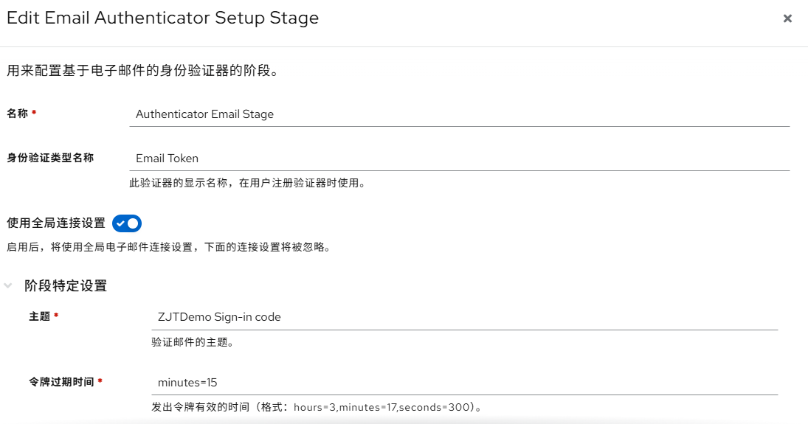
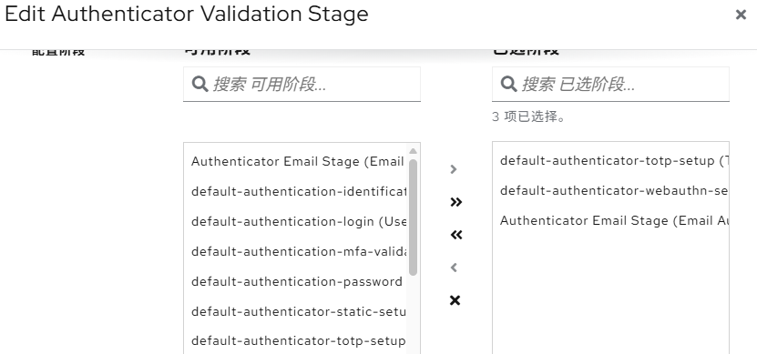
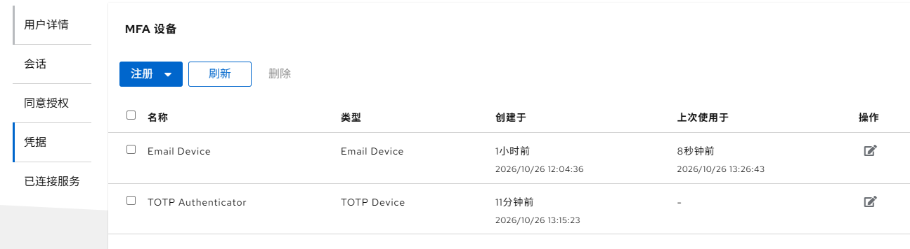
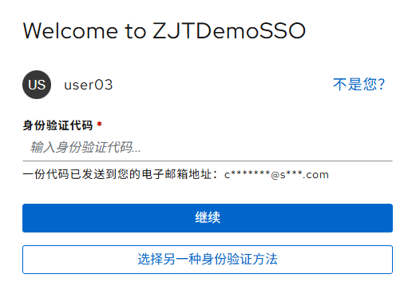
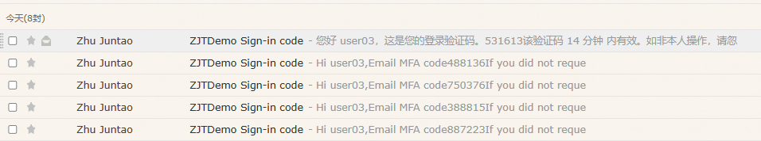
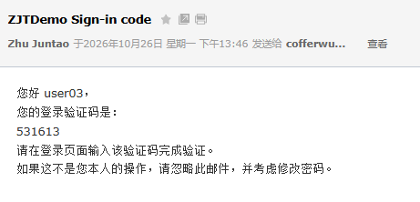

## 概述

本文记录为 authentik 配置邮箱验证码作为第二因素（Email MFA）的完整流程：SMTP 配置 → 创建邮件验证器 Stage → 在 MFA 验证阶段启用 Email → 绑定认证流 → 自定义邮件模板 → 验证。

> 核心提醒：**只创建 Email Stage 是不够的**。必须把它加入 MFA validation stage 的 Configuration stages，并勾选 Email Authenticators 设备类，登录时才会真正发送验证码。这是最常见的漏配点。

## 一、配置 SMTP

在 `.env` 中添加邮箱配置（465 端口对应 SSL）：

```env
AUTHENTIK_EMAIL__HOST=mail.ksomail.com
AUTHENTIK_EMAIL__PORT=465
AUTHENTIK_EMAIL__USE_SSL=true
AUTHENTIK_EMAIL__USE_TLS=false
AUTHENTIK_EMAIL__USERNAME=jt.zhu@[邮箱后缀已隐藏]
AUTHENTIK_EMAIL__PASSWORD=
AUTHENTIK_EMAIL__FROM=jt.zhu@[邮箱后缀已隐藏]
AUTHENTIK_EMAIL__TIMEOUT=10
```

> 说明：邮箱后缀（域名部分）已做脱敏处理，实际部署时请替换为贵单位的邮件域名。

测试邮件是否能正常发出：

```bash
docker compose run --rm worker ak test_email jt.zhu@[邮箱后缀已隐藏]
```

或进入 worker 容器后在内部执行：

```bash
docker compose exec worker /bin/bash
ak test_email jt.zhu@[邮箱后缀已隐藏]
```

> SSL 与 TLS 不要同时开启：465 用 `USE_SSL=true` / `USE_TLS=false`；587 则相反。

## 二、创建 Authenticator Email Stage

路径：**Flows & Stages → Stages → Create → Authenticator Email Stage**（部分版本名为 Email Authenticator Setup Stage）。

| 字段 | 建议值 |
| --- | --- |
| Name | `email-mfa-setup` |
| Friendly name | 邮箱验证码 |
| Token expiry | `minutes=10`（验证码有效期，别太长） |
| Subject | 你的验证码（或留默认） |
| Template | 留空用内置默认 |
| From address | 留空 → 使用 `.env` 的 FROM |
| Use global settings | 勾选（继承第 1 步的 SMTP） |
| Configure Flow | 可留空（仅「用户自助添加设备」时才需要） |

它的作用：用户被要求注册 Email MFA 时，authentik 向用户档案中的 email 发送验证码，用户回填后完成注册。



## 三、在 MFA 验证阶段启用 Email（最关键）

编辑 `default-authentication-mfa-validation`（**Flows & Stages → Stages**）：

| 字段 | 必须设置 |
| --- | --- |
| Device classes | 勾选 **Email Authenticators**（可同时勾 TOTP / Static Tokens） |
| Not configured action | `Configure`（强制注册；测试期别用 Deny） |
| Configuration stages | 把第 2 步创建的 Email Stage 加入 **Selected Stages** |
| Last auth threshold | 默认 5 分钟即可 |
| Timeout | 默认即可 |

只建 Stage、不把它加进 Configuration stages，或者不勾 Device classes，登录时都不会发 token。



## 四、绑定认证流与用户邮箱

**1. 绑定到认证流**（SAML 登录实际走这条）

`Flows & Stages → Flows → default-authentication-flow → Stage Bindings`，确认 `default-authentication-mfa-validation` 已存在，且顺序在密码验证之后。

> 注意：第 2 步的 Email Stage **不要**直接绑到这里，它是通过 validation stage 的 Configuration stages 间接调用的。

**2. 用户 email 必须正确**

`Directory → Users → 目标用户 → Email` 字段是 token 的接收地址。LDAP 同步用户需确认 `mail` 属性已正确映射，不能为空。

## 五、验证

用一个尚未绑定 MFA 的测试用户：

1. 无痕窗口打开 `https://auth.example.com`。
2. 输入账号密码 → 应出现「选择验证方式」，其中包含 Email 选项。
3. 选择 Email → 页面提示「已发送验证码到 xxx@邮箱」。
4. 查收邮件（含垃圾箱）→ 回填验证码 → 完成登录。

> 只有用户**注册了邮箱认证**时才会触发发送 token 邮件；注册多种认证方式时，登录页会列出多个选项供选择。





## 六、自定义邮件模板

进入自定义模板目录并创建邮件 HTML：

```bash
cd ~/.docker/compose/authentik/custom-templates
sudo mkdir email
cd email
sudo vi email_otp.html
```

`email_otp.html` 示例：


```django

<!DOCTYPE html>
<html>
<head>
<meta charset="utf-8">
<meta name="viewport" content="width=device-width">
<style>
  body { font-family: Arial, "Microsoft YaHei", sans-serif; font-size: 14px; color: #212124; line-height: 1.6; }
  .box { max-width: 480px; margin: 0 auto; padding: 24px; border: 1px solid #e0e0e0; border-radius: 6px; }
  .code { font-size: 32px; letter-spacing: 8px; font-weight: 700; color: #1a73e8; text-align: center; padding: 16px 0; }
  .muted { color: #888; font-size: 12px; }
</style>
</head>
<body>
<div class="box">
  <p>您好 {{ user.username }}，</p>
  <p>您的登录验证码是：</p>
  <p class="code">{{ token }}</p>
  <p>请在登录页面输入该验证码完成验证。</p>
  <p class="muted">如果这不是您本人的操作，请忽略此邮件，并考虑修改密码。</p>
</div>
</body>
</html>
```


如需修改纯文本预览内容，编辑 `email_otp.txt`：

```django
您好 {{ username }}，这是您的登录验证码。
{{ token }}

该验证码 {{ expires }} 内有效。如非本人操作，请忽略此邮件。

--
authentik

```


配置完成后重建容器使模板生效：

```bash
docker compose up -d --force-recreate server worker
```





## 七、排障清单

| 现象 | 检查点 |
| --- | --- |
| 登录时不出现 Email 选项 | Device classes 是否勾选 Email Authenticators |
| 完全没有发邮件 | Email Stage 是否加入 validation stage 的 Configuration stages |
| SMTP 连接失败 | SSL/TLS 组合是否正确，密码是否正确，`ak test_email` 是否通过 |
| 收不到邮件 | 用户 email 是否为空，垃圾箱/反垃圾网关是否拦截 |
| 验证码提示过期 | Token expiry 是否过短，服务器时间是否同步 |

---

> 本文由 WorkBuddy AI 编辑整理。
