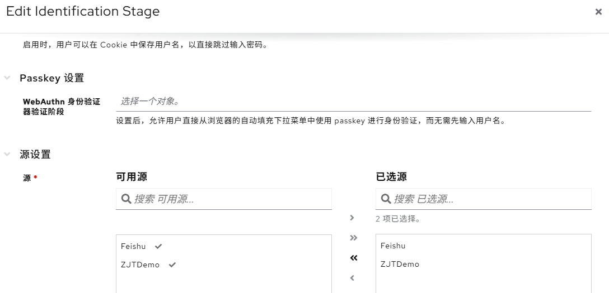

## 概述

本文记录用 authentik 对接飞书实现 SSO 登录的配置。飞书不提供标准的 OIDC discovery 端点，需要用 OAuth（Generic）方式手工填写授权、令牌与用户信息 URL，并注意 scopes 的覆盖规则。

## 一、飞书开放平台侧准备

在飞书开放平台创建企业自建应用，开启「网页应用」能力，并在「凭证与基础信息」中获取 App ID 与 App Secret。在「安全设置」中配置重定向 URL，指向 authentik 的回调地址（见下方参数表）。

## 二、创建 OAuth Source

进入 **Customization → Sources → Create**，选择 OAuth 类型，按以下参数填写：

| 字段 | 值 |
| --- | --- |
| Name | Feishu |
| Slug | `feishu`（必须与回调 URL 中的 slug 一致） |
| Consumer key | 飞书 App ID |
| Consumer secret | 飞书 App Secret |
| Scopes | `* contact:user.base:readonly contact:user.email:readonly contact:user.employee_id:readonly` |
| OIDC Well-known URL | 留空（飞书不提供标准 `/.well-known/openid-configuration`） |
| Authorization URL | `https://accounts.feishu.cn/open-apis/authen/v1/authorize` |
| Access token URL | `https://open.feishu.cn/open-apis/authen/v2/oauth/token` |
| Profile URL | `https://passport.feishu.cn/suite/passport/oauth/userinfo` |
| JWKS URL / Issuer | 留空 |

**两个关键点：**

1. Scopes 开头的 `*` 表示**覆盖** authentik 默认 scopes，而不是追加。不加 `*`，authentik 会带上默认的 `openid profile email`，飞书因未开通这些 scope 会直接报错。
2. 如果当前版本强制要求填写 Well-known URL，把 Provider type 改为 **OAuth（Generic）**，三个 URL 照填即可，效果等价。

Source 表单里的 Flow settings 保持默认：`Authentication flow = default-source-authentication`，`Enrollment flow = default-source-enrollment`。

## 三、参数对照

| 项目 | 值 |
| --- | --- |
| authentik 访问地址 | `http://auth.zjtdemo.cloud:9000` |
| authentik host 配置值（System → Configuration） | `http://auth.zjtdemo.cloud:9000` |
| 飞书应用 App ID（Client ID） | `cli_aa5b6a1226385c10` |
| 飞书应用 App Secret（Client Secret） | 见飞书开放平台「凭证与基础信息」 |
| authentik 回调 URL | `http://auth.zjtdemo.cloud:9000/source/oauth/callback/feishu/` |
| 飞书侧「重定向 URL」 | 与上一行一字不差 |

> 回调 URL 必须逐字符一致（含协议、端口、结尾斜杠），否则飞书会拒绝授权请求。

## 四、自定义属性映射

把飞书 ID 落进用户 attributes，便于下游应用做账号关联。进入 **Customization → Property Mappings → Create → OAuth Source Mapping**，填入：

```python
return {
    "username": info.get("user_id") or info.get("sub"),
    "email": info.get("email") or info.get("enterprise_email"),
    "name": info.get("name") or info.get("en_name"),
    "attributes": {
        "feishu_open_id": info.get("sub"),
        "feishu_union_id": info.get("union_id"),
        "feishu_user_id": info.get("user_id"),
        "feishu_tenant_key": info.get("tenant_key"),
        "avatar": info.get("picture"),
    },
}
```

创建后，在 Source 的 Property mappings 中挂上它，替换默认映射。

## 五、挂到登录页

依次进入：

```
Flows and Stages → Flows → default-authentication-flow
  → Stage Bindings → default-authentication-identification → Edit Stage
  → Source Settings → Available Sources
```

把 Feishu 从 Available Sources 移到 Selected Sources。勾选 **Show sources' labels**，否则登录页只显示图标、不显示文字。



## 六、验证与排障

- 无痕窗口打开登录页，确认出现飞书登录入口。
- 点击后跳转到飞书授权页，确认应用名称与权限申请正确。
- 授权后应正常回跳并创建/关联用户，检查用户 email 与 attributes 是否正确写入。
- 若报错 `redirect_uri mismatch`，对照参数表检查飞书侧重定向 URL。
- 若报错 `invalid scope`，确认 scopes 前的 `*` 是否存在，且飞书应用已开通对应权限。

---

> 本文由 WorkBuddy AI 编辑整理。
