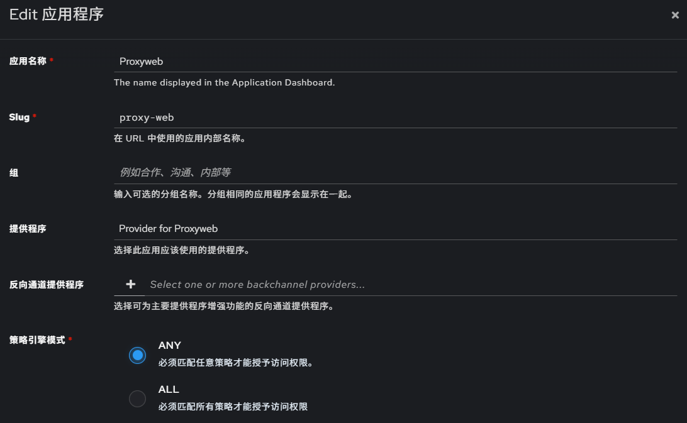
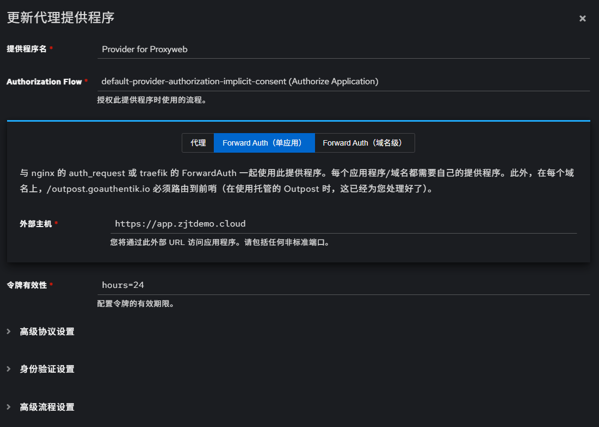
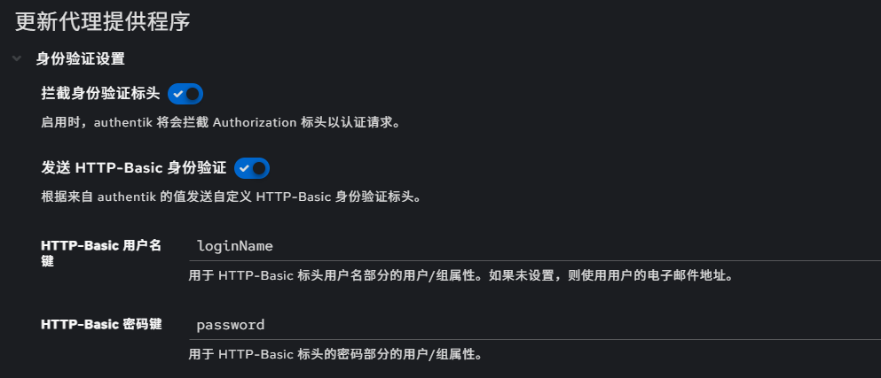
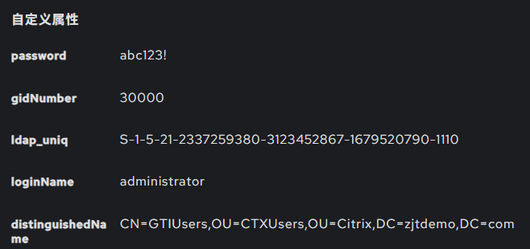
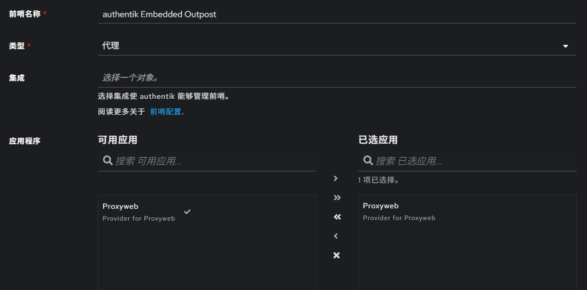
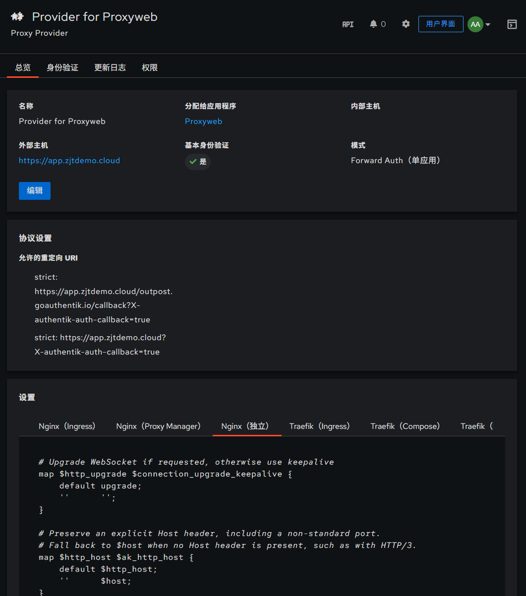
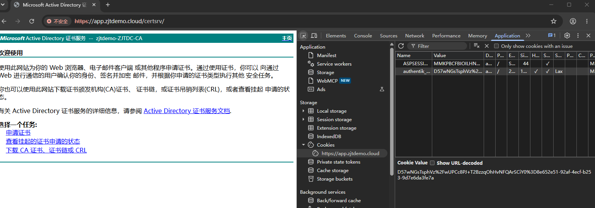
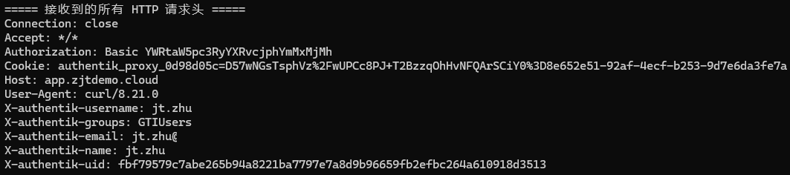

## 概述

本文记录用 Nginx 的 `auth_request` 模块对接 authentik outpost，为单个后端应用（示例为 IIS 站点 `app.zjtdemo.cloud`）做 Forward Auth 前置认证。浏览器访问应用时，Nginx 先向 outpost 发起鉴权子请求，通过后把 authentik 校验出的身份头（用户名、组、邮箱等）注入后端，401 时跳转到登录流程。

## 一、创建 proxy 应用与 Provider

1. 在 authentik 中创建 **Application**，Slug 记为 `app`。
2. 创建 **Proxy Provider**，External host 填 `https://app.zjtdemo.cloud`。
3. 在 Provider 的「Authentication flow」中确认使用默认认证流。
4. 勾选 **Send HTTP Basic authentication**，让 outpost 把凭据通过 `Authorization` 头传给后端（IIS 场景需要）。

DNS 侧把 `app.zjtdemo.cloud` 解析到 authentik/Nginx 所在主机 `192.168.3.26`。









## 二、把应用加入 Outpost

进入 **Outposts → default-authentication-outpost → Applications**，把刚才创建的 proxy 应用加入 Selected Applications。只有加入后，outpost 才会为该应用匹配 Provider 并返回身份头。



## 三、Nginx 配置

Provider 详情页会给出官方配置样例，下面的版本针对单应用场景做了整合与注释。

### 1. 安装并放置共享 map

```bash
sudo apt install -y nginx
sudo cp nginx-authentik-maps.conf /etc/nginx/conf.d/authentik-maps.conf
```

`/etc/nginx/conf.d/authentik-maps.conf` 内容（**必须放在 http 上下文**，多个 vhost 共用，避免重复定义 map 导致 `duplicate map` 报错——这也是配置 reload 不生效的常见坑）：

```nginx
# WebSocket 升级：非升级请求保持空值（比写死 close 更利于 keep-alive）
map $http_upgrade $connection_upgrade_keepalive {
    default upgrade;
    ''      '';
}

# 保留显式 Host 头（含非标准端口，如 :9443）；无 Host 时回退 $host
map $http_host $ak_http_host {
    default $http_host;
    ''      $host;
}
```

### 2. 应用 vhost

```bash
sudo cp nginx-forward-auth-single-app.conf /etc/nginx/sites-available/app.conf
sudo ln -s /etc/nginx/sites-available/app.conf /etc/nginx/sites-enabled/
```

`app.conf` 关键内容：

```nginx
server {
    listen 443 ssl;                 # 对外发布 https://app.zjtdemo.cloud
    http2 on;
    server_name app.zjtdemo.cloud;

    ssl_certificate     /etc/nginx/ssl/auth.zjtdemo.cloud/zjtdemo.cloud.pem;
    ssl_certificate_key /etc/nginx/ssl/auth.zjtdemo.cloud/zjtdemo.cloud.key;

    # 身份头体积较大，放大缓冲避免 502 upstream sent too big header
    proxy_buffers 8 16k;
    proxy_buffer_size 32k;

    location / {
        proxy_pass https://zjtdc.zjtdemo.com;   # 需要保护的内部业务地址
        proxy_set_header Host $ak_http_host;

        # ---------- authentik 固定段 ----------
        # 每个请求发认证子请求给 outpost（沿用当前 Host，outpost 据此匹配 Provider）
        auth_request /outpost.goauthentik.io/auth/nginx;
        error_page 401 = @goauthentik_proxy_signin;

        # 回传会话 Cookie（漏掉会无限重定向）
        auth_request_set $auth_cookie $upstream_http_set_cookie;
        add_header Set-Cookie $auth_cookie;

        # 把 outpost 校验出的身份头传给后端
        auth_request_set $authentik_username     $upstream_http_x_authentik_username;
        auth_request_set $authentik_groups       $upstream_http_x_authentik_groups;
        auth_request_set $authentik_entitlements $upstream_http_x_authentik_entitlements;
        auth_request_set $authentik_email        $upstream_http_x_authentik_email;
        auth_request_set $authentik_name         $upstream_http_x_authentik_name;
        auth_request_set $authentik_uid          $upstream_http_x_authentik_uid;

        proxy_set_header X-authentik-username     $authentik_username;
        proxy_set_header X-authentik-groups       $authentik_groups;
        proxy_set_header X-authentik-entitlements $authentik_entitlements;
        proxy_set_header X-authentik-email        $authentik_email;
        proxy_set_header X-authentik-name         $authentik_name;
        proxy_set_header X-authentik-uid          $authentik_uid;

        # Provider 勾选 "Send HTTP Basic authentication" 时才启用
        auth_request_set $authentik_auth $upstream_http_authorization;
        proxy_set_header Authorization $authentik_auth;
    }

    # 登录回跳路径：必须无需认证即可访问，否则重定向循环
    location /outpost.goauthentik.io {
        proxy_pass http://127.0.0.1:19000/outpost.goauthentik.io;
        # 单应用模式：Host 用应用域名，outpost 据此定位 Provider
        proxy_set_header Host           $ak_http_host;
        proxy_set_header X-Original-URL $scheme://$ak_http_host$request_uri;

        auth_request_set $auth_cookie $upstream_http_set_cookie;
        add_header Set-Cookie $auth_cookie;

        proxy_pass_request_body off;
        proxy_set_header Content-Length "";
    }

    # 401 时跳转到登录流程；单应用模式用相对路径
    location @goauthentik_proxy_signin {
        internal;
        add_header Set-Cookie $auth_cookie;
        return 302 /outpost.goauthentik.io/start?rd=$scheme://$ak_http_host$request_uri;
    }
}
```



应用配置后执行 `sudo nginx -t && sudo systemctl reload nginx` 使其生效。

## 四、排障：验证身份头是否传到后端

在 IIS 后端根目录（默认 `C:\inetpub\wwwroot`）新建 `test.aspx`，用于打印收到的所有请求头：

```aspx
<%@ Page Language="C#" %>
<%
Response.ContentType = "text/plain; charset=utf-8";
Response.Write("===== 接收到的所有 HTTP 请求头 =====\r\n");
foreach (string key in Request.Headers.AllKeys)
{
    Response.Write(key + ": " + Request.Headers[key] + "\r\n");
}
Response.Write("\r\n===== 客户端信息 =====\r\n");
Response.Write("客户端 IP: " + Request.UserHostAddress + "\r\n");
%>
```



带上认证会话 Cookie 请求该测试页：

```bash
curl.exe -v -k -b "authentik_proxy_0d98d05c=..." https://app.zjtdemo.cloud/test.aspx
```

如果响应中能看到 `X-authentik-username` / `Authorization` 等头，说明账号密码与身份信息已成功传递到后端。



常见故障速查：

| 现象 | 原因与处理 |
| --- | --- |
| 无限重定向 | `Set-Cookie` 未回传，或 `/outpost.goauthentik.io` 路径被误加了鉴权 |
| 502 upstream sent too big header | 身份头过大，调大 `proxy_buffer_size` |
| `duplicate map` 报错 | map 定义被重复写进多个 vhost，应抽到 `conf.d` 共享 |
| 后端收不到身份头 | Provider 未加入 Outpost 的 Applications 列表 |

---

> 本文由 WorkBuddy AI 编辑整理。
