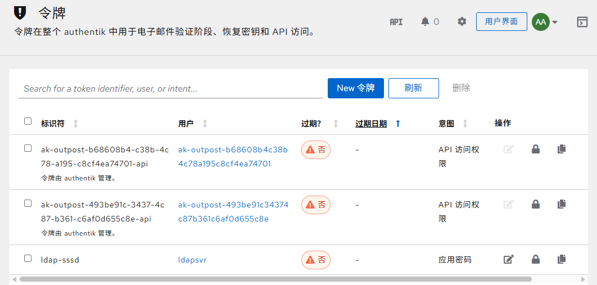
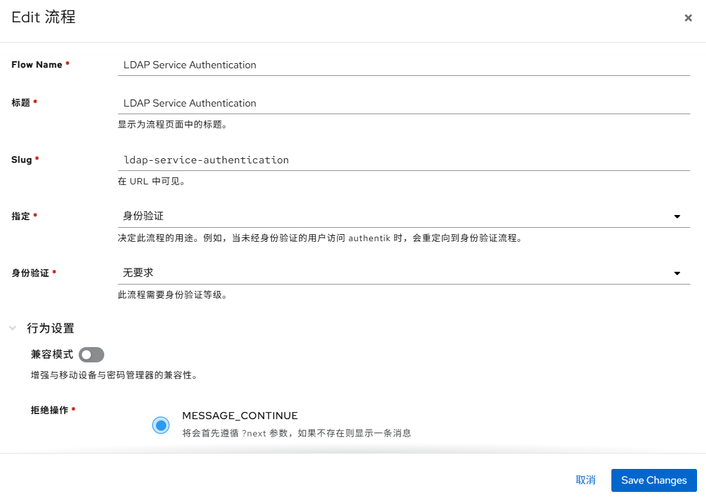
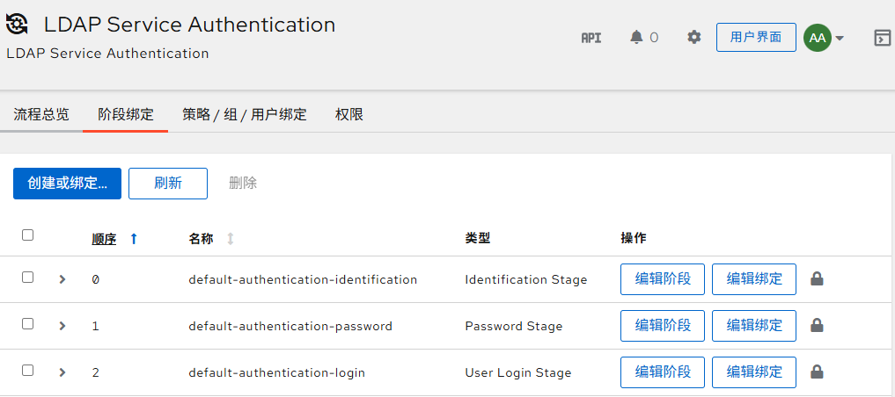
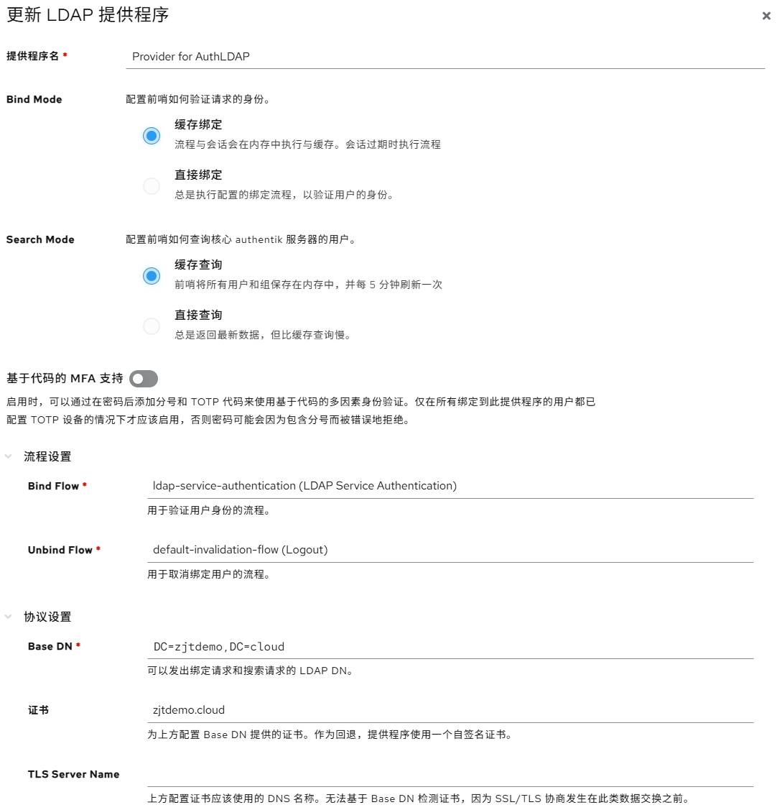
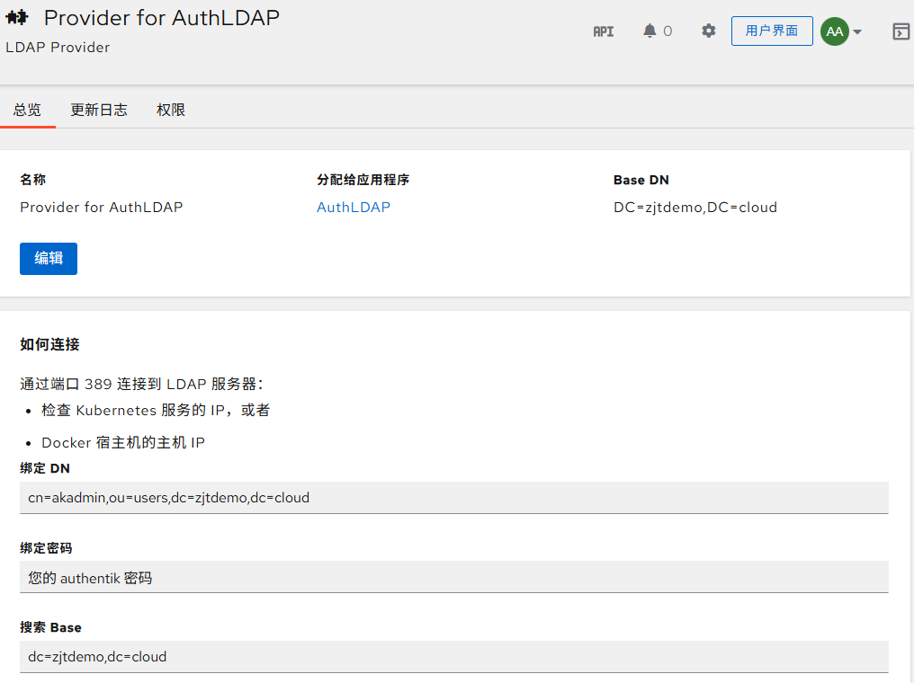
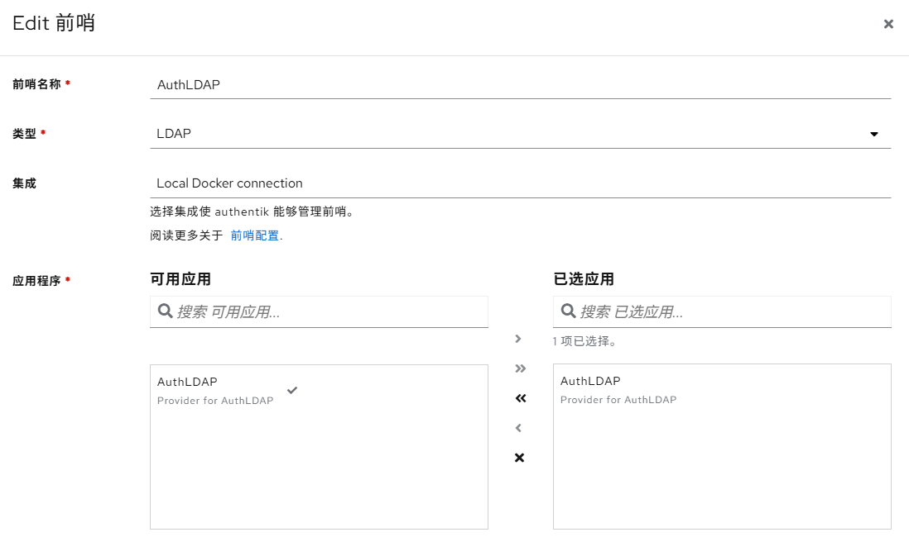
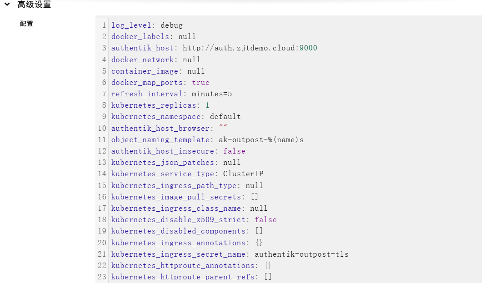
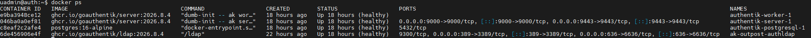
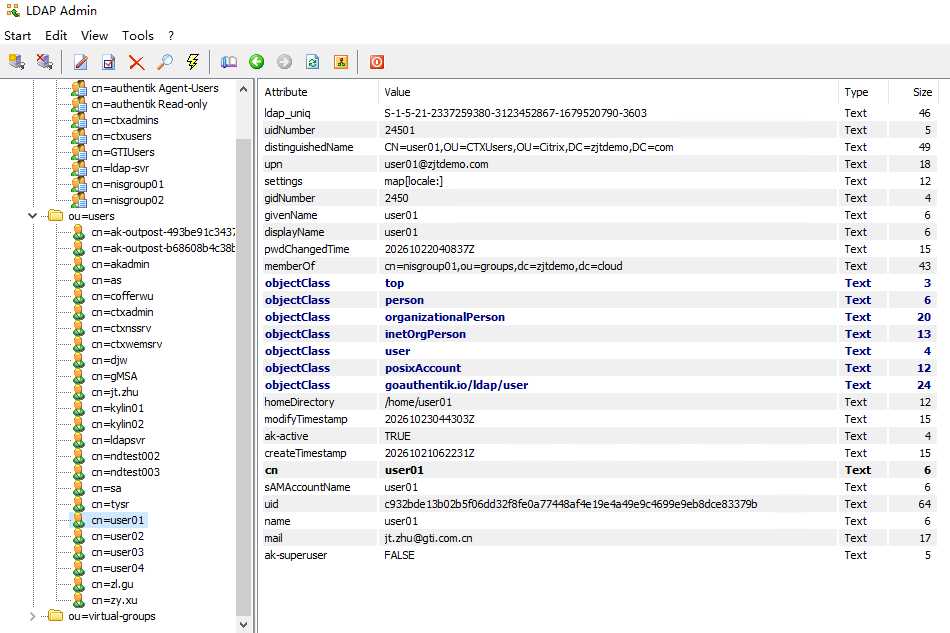

<p class="back-index"><a href="index.html">← 返回文章索引</a></p>


## 概述

Authentik 的 LDAP outpost 可以把 Web 侧的用户目录以标准 LDAP / LDAPS 协议暴露给 Linux 主机，让 sssd 等传统 PAM 组件复用同一套账号体系。本文记录从服务账号、认证流到 Linux 接入的完整配置，并附上排障命令与已知限制。

> 说明：文中示例域名 `zjtdemo.cloud`、内网 IP `192.168.3.26` 为测试环境值，实际部署请替换。

## 一、准备服务账号

创建一个专用账号 `ldapsvr` 作为 LDAP 绑定账号。**该账号不应启用 MFA**——Linux 侧的 bind 请求无法完成二次验证。

接着为该账号创建「用户应用程序密码」：通过 HTTPS 访问平台后复制该密码，用于后续 sssd 配置中的 `ldap_default_authtok`。应用程序密码与登录密码不同，泄漏后可在用户设置中单独吊销。



## 二、创建独立的认证 Flow

LDAP bind 需要一个不含 MFA 阶段的认证流程：

1. 复制 `default-authentication-flow`，创建一个独立 Flow。
2. 进入 Stage Bindings，删除或禁用 MFA 相关阶段，只保留密码验证。
3. 保存后记下 Flow 的标识，供 Provider 引用。

这一步是核心：**如果复用带 MFA 的默认 Flow，Linux 登录会在 bind 阶段卡住**，因为命令行没有输入验证码的交互界面。





## 三、创建 LDAP 应用与 Provider

在 Applications 中创建应用，然后创建 Provider：

- Provider 类型选择 **LDAP**。
- 绑定上一步创建的无 MFA 认证 Flow。
- 用户搜索基数按目录结构调整（示例：`ou=users,dc=zjtdemo,dc=cloud`）。





## 四、创建 Outpost

在 Outposts 中新建，选择 **Docker 集成**，authentik 会自动生成 `ak-outpost-authldap` 容器并绑定应用。

修改高级设置：

- `authentik_host`：改成实际的 server 地址（示例 `http://server:9000`），不要保留默认的 `/`。
- 确认 outpost 与 server 处于同一个 Docker 网络，否则无法通过容器名回连。







## 五、Linux 侧 sssd 配置

安装 `sssd` 与 LDAP 工具后，写入 `/etc/sssd/sssd.conf`：

```ini
[sssd]
domains = zjtdemo.cloud
services = nss, pam

[domain/zjtdemo.cloud]
id_provider = ldap
auth_provider = ldap
ldap_uri = ldaps://auth.zjtdemo.cloud:636
ldap_tls_cacert = /etc/pki/ca-trust/source/anchors/ZJTDC_CA.cer
ldap_tls_reqcert = demand
ldap_opt_timeout = 30
ldap_user_search_base = ou=users,dc=zjtdemo,dc=cloud
ldap_group_search_base = dc=zjtdemo,dc=cloud
ldap_default_bind_dn = cn=ldapsvr,ou=users,dc=zjtdemo,dc=cloud
ldap_default_authtok = <应用程序密码>
ldap_user_name = cn
default_shell = /bin/bash
ldap_id_mapping = false
fallback_homedir = /home/%u
```

配置要点：

- `ldap_tls_reqcert = demand` 强制校验证书链，需先把签发 CA 放到 anchors 目录并执行 `update-ca-trust`。
- `ldap_id_mapping = false` 表示直接使用目录中的 `uidNumber` / `gidNumber`，前提是所有用户都已分配这两个属性。
- `default_shell` 必须显式指定，因为 authentik 不提供 `loginShell` 属性。
- 修改配置后执行 `chmod 600 /etc/sssd/sssd.conf`，再 `systemctl restart sssd`。

## 六、排障

Outpost 配置变更后先重启容器：

```bash
docker restart ak-outpost-authldap
```

**1. 纯 bind 测试（不含搜索）**

```bash
ldapwhoami -x -H ldap://192.168.3.26:389 \
  -D "cn=ldapsvr,ou=users,dc=zjtdemo,dc=cloud" -W
```

返回 `dn:cn=ldapsvr,...` 即表示账号密码与 Flow 正常。

**2. 目录搜索（必须显式列属性）**

```bash
ldapsearch -x -H ldap://192.168.3.26:389 \
  -D "cn=ldapsvr,ou=users,dc=zjtdemo,dc=cloud" -W \
  -b "ou=users,dc=zjtdemo,dc=cloud" "(objectClass=*)" \
  cn uidNumber gidNumber homeDirectory objectClass
```

**3. LDAPS 与证书链校验**

```bash
openssl s_client -connect auth.zjtdemo.cloud:636 < /dev/null | grep "Verify return"
```

期望输出 `Verify return code: 0 (ok)`。若非 0，检查 CA 证书与服务器名称是否匹配。



## 七、已知限制

- 不提供 `loginShell` 属性，必须在 sssd 中显式配置 `default_shell`。
- 不提供 sudo 规则、automount、netgroups、Kerberos 等 NSS 信息。
- 不支持 LDAP Password Modify 扩展，修改密码需走 Web 后台。
- Linux 登录只校验密码（走无 MFA 的 bind flow），MFA 仅覆盖 Web 侧访问。

---

> 本文由 WorkBuddy AI 编辑整理。
