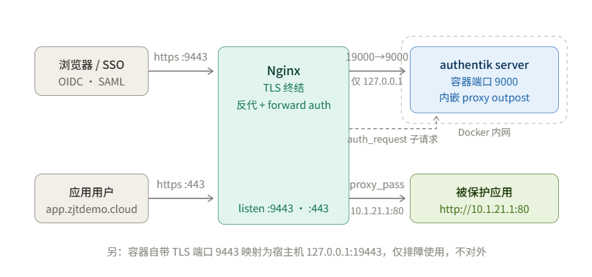
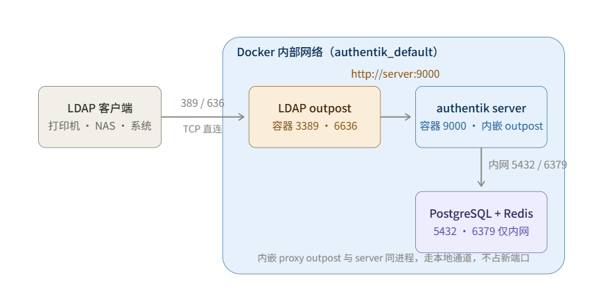
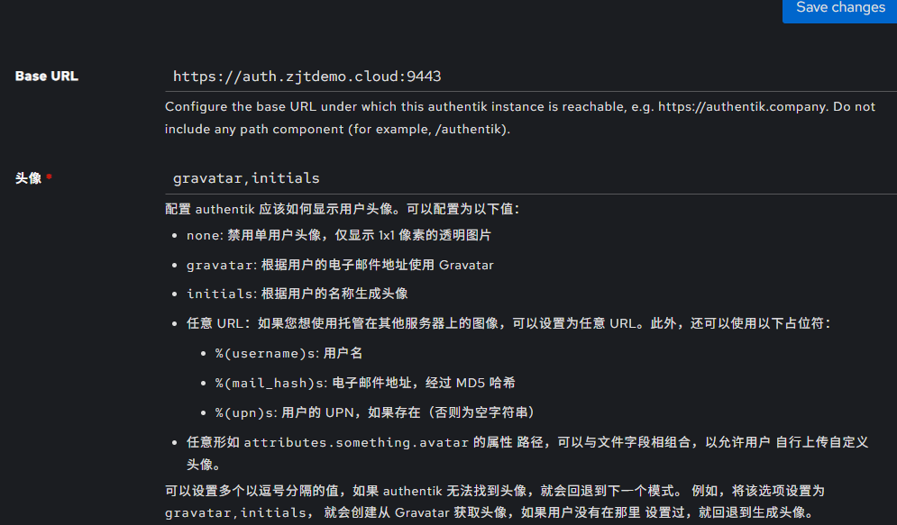
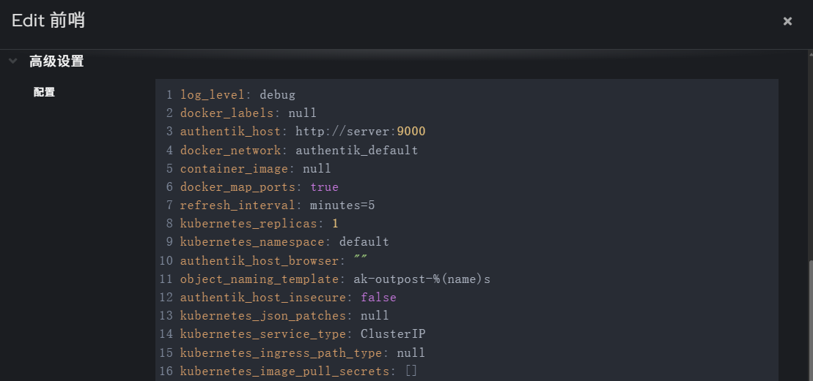

## 概述

本文梳理 authentik 部署中各类流量的走向：HTTPS 认证流量、应用流量、auth_request 鉴权子请求、LDAP 流量以及 Docker 内网回连。明确端口与暴露范围后，才能正确配置 Nginx、compose 与 outpost，避免出现回调地址错误或端口冲突。

## 一、流量总览

**HTTPS 认证与应用流量**：浏览器走 9443 进入 authentik，应用用户走 443 访问被保护应用，鉴权子请求由 Nginx 在内部完成。



**LDAP 流量与 Docker 内部连接**：LDAP 客户端直连 outpost 容器，outpost 经 Docker 内网回连 server，完全不经过 Nginx。



server 容器的 9000 端口通过 NAT 映射到宿主机 19000：

```
宿主机                        Docker 网络内部
┌──────────────────────┐      ┌────────────────────────┐
│ :19000 ──────────────┼──NAT─┼──> server 容器 :9000   │
└──────────────────────┘      └────────────────────────┘
        ↑                                  ↑
   Nginx 走这里                     outpost 容器走这里
   （127.0.0.1:19000）             （server:9000，不经过宿主机）
```

### 端口与暴露范围对照表

| 序号 | 流量路径 | 宿主机端口 | 容器端口 | 暴露范围 | 说明 |
| --- | --- | --- | --- | --- | --- |
| 1 | 浏览器/SSO → Nginx → server | 9443 (Nginx TLS) → 127.0.0.1:19000 | 9000 | 公网 | 认证主入口，导入证书 |
| 2 | 应用用户 → Nginx → 被保护应用 | 443 (Nginx TLS) | — | 公网 | forward auth 单应用模式，后端 `https://zjtdc.zjtdemo.com` |
| 3 | auth_request 鉴权子请求 | 127.0.0.1:19000 | 9000 | 仅回环 | Nginx 内部完成，用户无感 |
| 4 | 排障通道 | 127.0.0.1:19443 | 9443 | 仅回环 | 容器自带 TLS，日常不用 |
| 5 | LDAP 客户端 → LDAP outpost | 389 / 636 | 3389 / 6636 | 内网 | TCP 直连，不经过 Nginx |
| 6 | LDAP outpost → server 回连 | —（Docker 内网） | 9000 | 仅 Docker 网络 | `http://server:9000`，明文，无证书需求 |
| 7 | server → PostgreSQL / Redis | —（Docker 内网） | 5432 / 6379 | 仅 Docker 网络 | 不映射宿主机 |
| 8 | Prometheus 指标 | 不映射 | 9300 | — | 端点无鉴权，官方建议不暴露 |

## 二、证书准备

把导入的 pfx 证书导出为证书和私钥文件：

```bash
openssl pkcs12 -in zjtdemo.cloud.pfx -nocerts -nodes -out zjtdemo.cloud.key
openssl pkcs12 -in zjtdemo.cloud.pfx -nokeys -out zjtdemo.cloud.pem
```

为 Nginx 建立 SSL 目录并存放证书。私钥权限设为 600，证书链需包含中间证书：

```bash
sudo mkdir -p /etc/nginx/ssl/auth.zjtdemo.cloud
sudo cp zjtdemo.cloud.* /etc/nginx/ssl/auth.zjtdemo.cloud/
sudo chmod 600 /etc/nginx/ssl/auth.zjtdemo.cloud/zjtdemo.cloud.key
```

## 三、Nginx 反代配置

```bash
sudo cp nginx-authentik-server.conf /etc/nginx/sites-available/authentik.conf
sudo ln -s /etc/nginx/sites-available/authentik.conf /etc/nginx/sites-enabled/
```

站点配置要点：

```nginx
server {
    listen 9443 ssl;
    http2 on;
    server_name auth.zjtdemo.cloud;

    # 导入的证书（不走 certbot）；私钥权限 600，fullchain 需含中间证书
    ssl_certificate     /etc/nginx/ssl/auth.zjtdemo.cloud/zjtdemo.cloud.pem;
    ssl_certificate_key /etc/nginx/ssl/auth.zjtdemo.cloud/zjtdemo.cloud.key;

    # 上传应用图标、证书、Blueprint 时避免 413
    client_max_body_size 10m;

    location / {
        proxy_pass http://127.0.0.1:19000;
        proxy_http_version 1.1;   # 2026.8 要求 HTTP/1.1+（outpost 走 WebSocket 回连）

        # 非标准端口：必须用 $http_host 保留端口号，否则生成的回调地址会丢端口
        proxy_set_header Host              $http_host;
        proxy_set_header X-Forwarded-Host  $http_host;
        proxy_set_header X-Forwarded-Proto $scheme;
        proxy_set_header X-Forwarded-Port  $server_port;   # 传 9000，用于生成正确 URL
        proxy_set_header X-Forwarded-For   $proxy_add_x_forwarded_for;
        proxy_set_header X-Real-IP         $remote_addr;

        # WebSocket（管理界面与 outpost 通信依赖）
        proxy_set_header Upgrade    $http_upgrade;
        proxy_set_header Connection $connection_upgrade_keepalive;
        proxy_read_timeout 300s;

        # 身份头较大，放大缓冲避免 502 upstream sent too big header
        proxy_buffers 8 16k;
        proxy_buffer_size 32k;
    }
}
```

应用配置并重载：

```bash
sudo nginx -t && sudo systemctl reload nginx
```

## 四、compose 端口覆盖

用 `compose.override.yml` 把 server 端口限制在回环地址，避免 9000 直接暴露：

```yaml
services:
  server:
    ports:
      !override
      - "127.0.0.1:19000:9000"
      - "127.0.0.1:19443:9443"
```

将 authentik 内部服务端口改为 19000 和 19443 后，外部只通过 Nginx 的 9443/443 进入。



## 五、Outpost 配置

在 outpost 高级设置中配置 `authentik_host` 为 Docker 内网可解析的 server 地址（示例 `http://server:9000`），并指定 `docker_network`。Docker 自动创建的 LDAP outpost 会和 server 处于同一网络，因此可直接访问 server，无需经过宿主机端口映射。



---

> 本文由 WorkBuddy AI 编辑整理。
