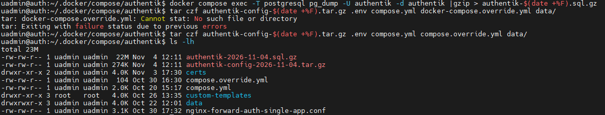
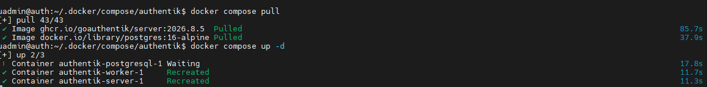
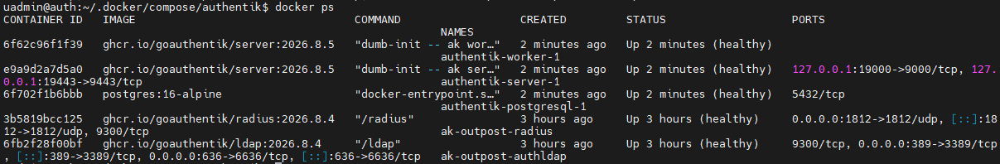

## 概述

authentik 升级前必须先备份数据库与配置，因为升级会带来不可逆的数据库 schema 迁移，且官方**不支持降级**。本文记录一次从旧版本升级到 2026.8.5 的完整流程，包括备份、升级、outpost 重建，以及异常时的回滚步骤。

## 一、升级前备份

进入 compose 目录：

```bash
cd ~/.docker/compose/authentik
```

导出数据库（service 名是 `postgresql`）：

```bash
docker compose exec -T postgresql \
  pg_dump -U authentik -d authentik | gzip > authentik-$(date +%F).sql.gz
```

备份配置三件套。**密钥一旦丢失，所有会话和加密数据都会报废**，因此 `.env` 与 `data/` 必须一并备份：

```bash
tar czf authentik-config-$(date +%F).tar.gz .env compose.yml compose.override.yml data/
ls -lh authentik-*.gz
```



> 建议把备份文件复制到另一台主机或对象存储，避免与 compose 目录同盘损坏。

## 二、执行升级

在 `.env` 中固定目标版本：

```env
AUTHENTIK_TAG=2026.8.5
```

拉取镜像并重建：

```bash
docker compose pull
docker compose up -d
```

观察 server / worker 日志，确认数据库迁移完成、服务恢复正常。





## 三、重建 Outpost

升级后如果 outpost 版本与 server 不一致，认证会失败。删除旧容器：

```bash
docker rm -f ak-outpost-radius
```

然后在 authentik 管理界面的 Outposts 页面中，对应 outpost 选择「Re-create Docker container」，让系统按新版本重新生成容器。

## 四、回滚（升级后异常时）

由于没有降级支持，回滚顺序是「停 → 恢复库 → 固定旧 tag 启动」：

```bash
docker compose down

# 清空当前 schema 后恢复备份
docker compose up -d postgresql
docker compose exec -T postgresql psql -U authentik -d authentik \
  -c 'DROP SCHEMA public CASCADE; CREATE SCHEMA public;'

# 或直接重建数据库卷后再导入
gunzip -c authentik-2026-11-04.sql.gz | \
  docker compose exec -T postgresql psql -U authentik -d authentik

# 固定旧 tag 后启动
sed -i 's/^AUTHENTIK_TAG=.*/AUTHENTIK_TAG=2026.8.4/' .env
docker compose up -d
```

> 回滚前提：升级前的数据库备份完整可用。操作前请再次确认备份文件可正常解压。

## 五、升级后维护

如果管理界面变慢（数据库迁移会让查询计划统计过时），登录数据库跑一次 `ANALYZE`：

```bash
docker compose exec -T postgresql psql -U authentik -d authentik -c 'ANALYZE;'
```

## 六、升级检查清单

- [ ] 数据库与配置三件套均已备份，且备份文件已异地保存
- [ ] `.env` 中 `AUTHENTIK_TAG` 已改为目标版本
- [ ] `docker compose pull` 与 `up -d` 执行完成，日志无报错
- [ ] Outpost 容器已重建，版本与 server 一致
- [ ] 登录、SSO、MFA 等核心流程验证通过

---

> 本文由 WorkBuddy AI 编辑整理。
