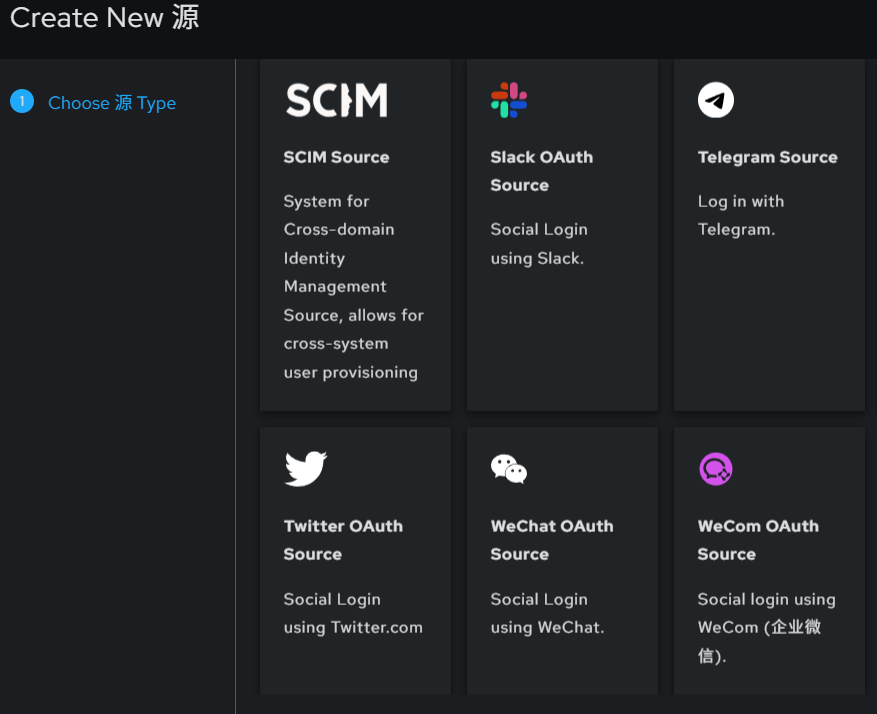
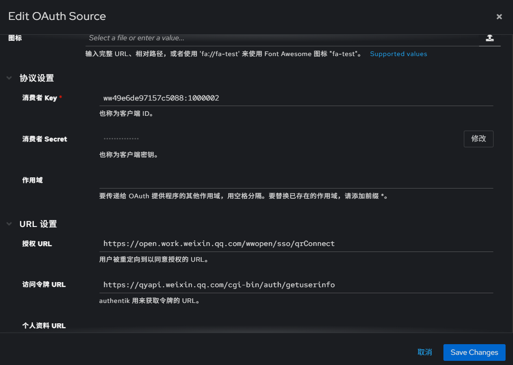
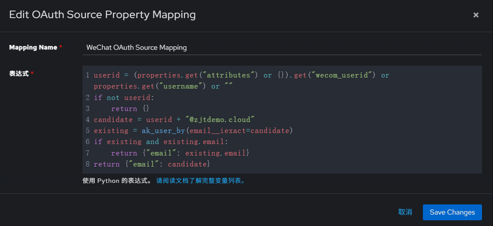
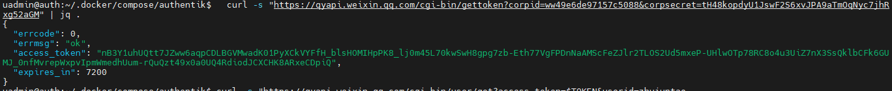
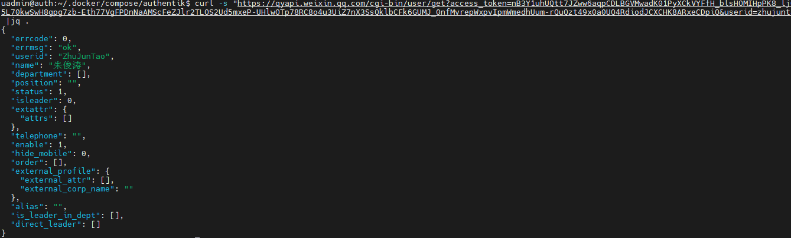

## 概述

为 Authentik 添加企业微信作为登录源，并解决一个关键问题：企业微信通讯录 API 只能拿到 `userid`，用户的邮箱字段需要在用户完成 OAuth 授权后才能获取。本文记录 Source 配置、属性映射脚本，以及通过接口验证字段获取情况的排障过程。

## 一、新增企业微信源

在企业微信开发者平台上创建企业应用，在应用信息上获取CorpID、AgentID、APPSecret等信息。
企业微信和钉钉一样都不能通过通用的OAuth Source来配置连接。通过Workbuddy 创建了wecom源模板，方便用户通过向导完成企业微信源的连接。
下载本文中的附件，将所有文件解压在Authentik docker compose工作目录，执行deploy.sh 来进行企业微信模板的添加。

部署时按以下顺序执行脚本，避免因阶段未就绪导致配置失败：

```bash
./deploy.sh check
docker compose up -d
./deploy.sh prepare
./deploy.sh config
./deploy.sh enable
docker compose up -d --force-recreate server worker
./deploy.sh verify
```
> 注意：当Authentik版本更新后，需要重新部署一次，才能继续附加企业微信源

进入 **Customization → Sources → Create**，选择企业微信（WeCom）类型，按向导填写 CorpID、AgentID、APPSecret 等凭据。保存后记录 Source 的 slug，用于拼回调 URL：

```
https://<authentik 域名>/source/oauth/callback/<slug>/
```

把该地址填入企业微信应用的可信域名与授权回调域。



注意这里需要填写 CorpID:AgentID ，因为企业微信构建扫码页面需要CorpID、AgentID、APPSecret三个属性，而Authentik默认的配置页面只有两行，因此将CorpID和AgentID整合在同一行中。




## 二、新增属性映射

企业微信返回的 `userid` 与 authentik 用户的 email 并非天然对应，需要一个映射脚本把 userid 转成邮箱，并在已存在用户时复用其邮箱：

```python
userid = (properties.get("attributes") or {}).get("wecom_userid") \
         or properties.get("username") or ""
if not userid:
    return {}

candidate = userid + "@zjtdemo.cloud"
existing = ak_user_by(email__iexact=candidate)
if existing and existing.email:
    return {"email": existing.email}

return {"email": candidate}
```

进入 **Customization → Property Mappings → Create**，选择对应的 Source Mapping 类型，把上述表达式填入并保存，然后在 Source 的 Property mappings 中挂载它。



## 三、排障：为什么拿不到邮箱

**现象**：通过企业微信通讯录 API 查询用户，只能得到 `userid`，邮箱等字段为空。

**原因**：通讯录接口（`user/get`）的返回字段受应用授权范围限制，只能访问用户ID，无法返回邮箱等隐私信息。因此不要依赖通讯录 API 补全邮箱，应确保登录流程中完成 OAuth 授权，并由上一节的属性映射脚本生成邮箱。

根据企业微信开发者平台提供的API信息，可以进行以下测试：

获取当前应用的 access_token：

```bash
curl -s "https://qyapi.weixin.qq.com/cgi-bin/gettoken?corpid=$CORPID&corpsecret=$CONTACT_SECRET" | jq .
```



用 该token 查询指定用户：

```bash
curl -s "https://qyapi.weixin.qq.com/cgi-bin/user/get?access_token=$TOKEN&userid=$USERID" | jq .
```



最终只返回了userid，因此需要通过自定义属性来合成用户的email属性，最后进行账号的匹配。

## 四、常见检查项

- 回调域名是否已加入企业微信应用的可信域名列表。
- Source 是否已加入 `default-authentication-identification` 的 Selected Sources。
- 属性映射是否已挂载，且用户邮箱不为空——邮箱为空会导致后续基于 email 的账号关联失败。

## 附件下载

- [wecom.zip](attachments/wecom.zip) — 本文配套部署包，含企业微信集成脚本（wecom.py、apps.py、deploy.sh、diagnose_wecom.py 等）

---

> 本文由 WorkBuddy AI 编辑整理，本人修改并定稿。
