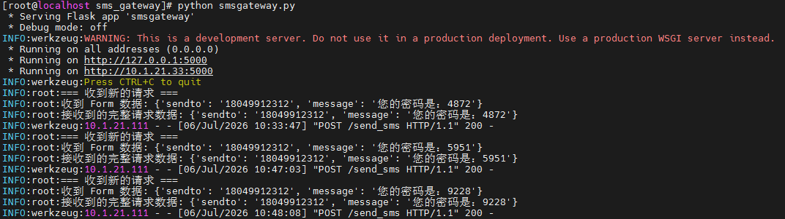
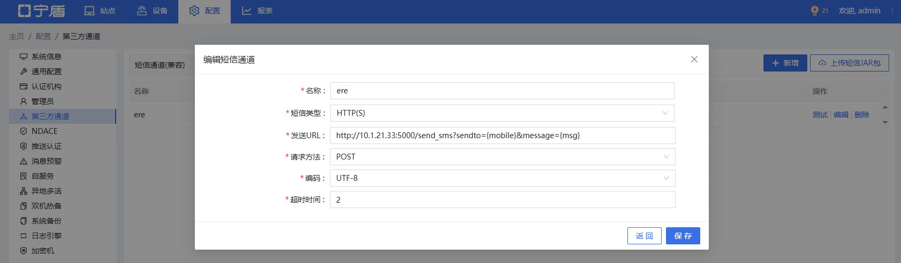

## 概述

宁盾可通过 HTTP 接口对接外部短信网关。本文在 Rocky Linux 上用 Flask 搭建一个轻量级的短信接收服务：无论宁盾以 JSON POST、表单 POST 还是 GET 参数方式调用，都能统一接收并记录请求内容，返回 `200 OK` 与约定格式的响应，便于先验证通道连通性，再接入真实短信发送逻辑。

## 一、环境准备

先备份原有 yum 源配置，再替换为阿里云镜像源以加速下载：

```bash
# 备份原有配置
cp -r /etc/yum.repos.d /etc/yum.repos.d.backup

# 替换为阿里云源
sed -e 's|^mirrorlist=|#mirrorlist=|g' \
    -e 's|^#baseurl=http://dl.rockylinux.org/$contentdir|baseurl=https://mirrors.aliyun.com/rockylinux|g' \
    -i.bak /etc/yum.repos.d/rocky*.repo

# 生成缓存
dnf makecache
```

安装 Python 与 Flask：

```bash
sudo dnf install python3 python3-pip -y
pip3 install flask
cd /opt/
```

## 二、创建短信网关服务

在 `/opt/` 下创建 `smsgateway.py`：

```python
from flask import Flask, request, jsonify
import logging

app = Flask(__name__)

# 设置日志级别，确保日志能被看到
logging.basicConfig(level=logging.INFO)


@app.route('/send_sms', methods=['POST', 'GET'])  # 同时允许 GET 和 POST，防止配错
def receive_sms():
    logging.info("=== 收到新的请求 ===")

    # 1. 获取数据（优先尝试 JSON，其次尝试表单）
    data = {}

    # 尝试解析 JSON body（宁盾 POST 常用方式）
    json_data = request.get_json(silent=True)
    if json_data:
        data = json_data
        logging.info(f"收到 JSON 数据: {data}")
    else:
        # 尝试解析 Form 表单（宁盾旧版本或 GET 常用方式）
        form_data = request.form.to_dict()
        if form_data:
            data = form_data
            logging.info(f"收到 Form 数据: {data}")
        else:
            # 如果是 GET，参数可能在 args 里
            args_data = request.args.to_dict()
            if args_data:
                data = args_data
                logging.info(f"收到 URL 参数: {data}")
            else:
                logging.warning("未检测到任何有效数据！")

    # 2. 直接记录接收到的完整数据（不再进行模板渲染）
    logging.info(f"接收到的完整请求数据: {data}")

    # 3. 返回成功响应（宁盾通常需要 200 OK 和特定格式）
    return jsonify({"status": "success", "message": "sent"}), 200


if __name__ == '__main__':
    # 务必绑定 0.0.0.0，否则宁盾服务器无法访问
    app.run(host='0.0.0.0', port=5000, debug=False)
```

代码要点：

- 路由同时接受 `POST` 与 `GET`，避免因为宁盾侧配置错误导致 405。
- `request.get_json(silent=True)` 在解析失败时返回 `None` 而不抛异常，因此可以安全地依次尝试 JSON → Form → URL 参数三种取数方式。
- 必须绑定 `0.0.0.0`，否则服务只监听回环地址，外部宁盾服务器无法访问。
- 生产环境请使用 `gunicorn` 或 `uwsgi` 运行，不要直接用 Flask 开发服务器。



## 三、配置宁盾侧

在宁盾管理界面添加 HTTP 短信通道，接口地址填写：

```
http://<服务器 IP>:5000/send_sms
```

按实际情况选择 POST（JSON 或 Form）方式，并配置手机号、短信内容等字段的映射。保存后发送一条测试短信，观察服务日志是否打印出完整请求数据。



## 四、验证与排障

```bash
# 启动服务
python3 /opt/smsgateway.py

# 本地模拟 POST 请求
curl -X POST http://127.0.0.1:5000/send_sms \
  -H "Content-Type: application/json" \
  -d '{"phone":"13800000000","content":"测试短信"}'
```

常见问题：

| 现象 | 检查点 |
| --- | --- |
| 宁盾侧报连接失败 | 防火墙是否放行 5000 端口；服务是否绑定 `0.0.0.0` |
| 收到请求但数据为空 | 确认宁盾使用的传参方式（JSON / Form / GET），日志会标明来源 |
| 宁盾认为发送失败 | 响应格式是否符合要求，状态码是否为 200 |
| 服务重启后失效 | 配置 systemd 服务实现开机自启 |

---

> 本文由 WorkBuddy AI 编辑整理。
