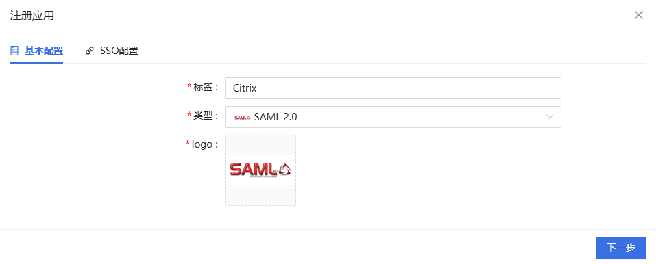
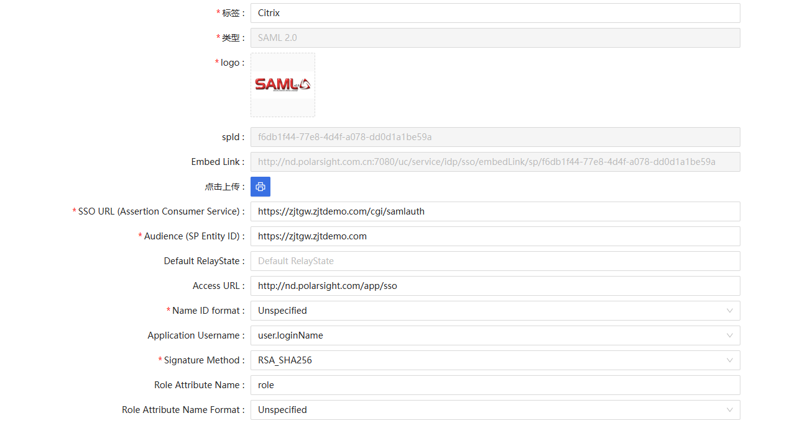
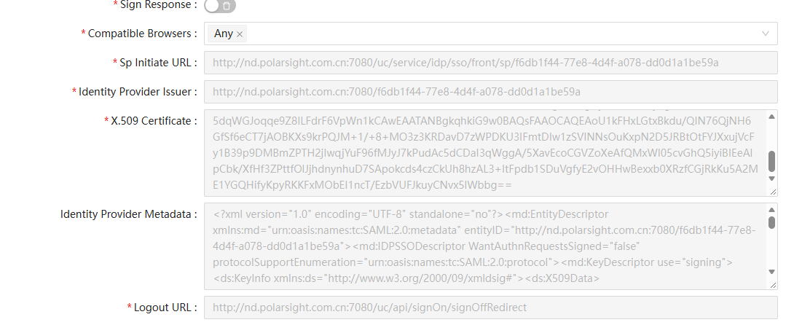
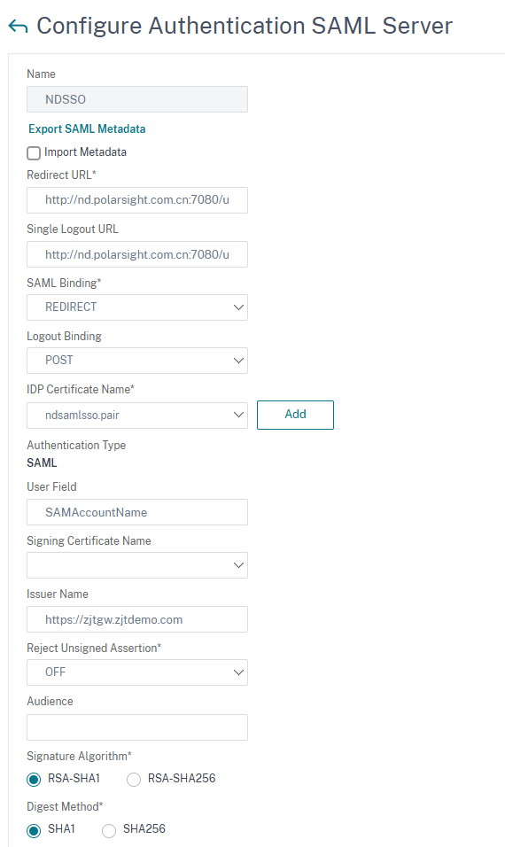
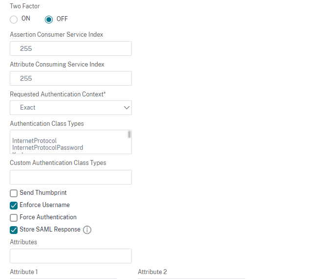
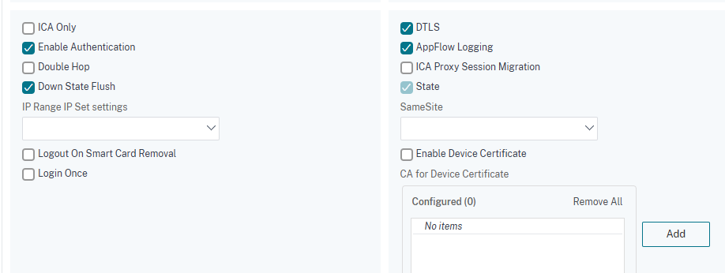
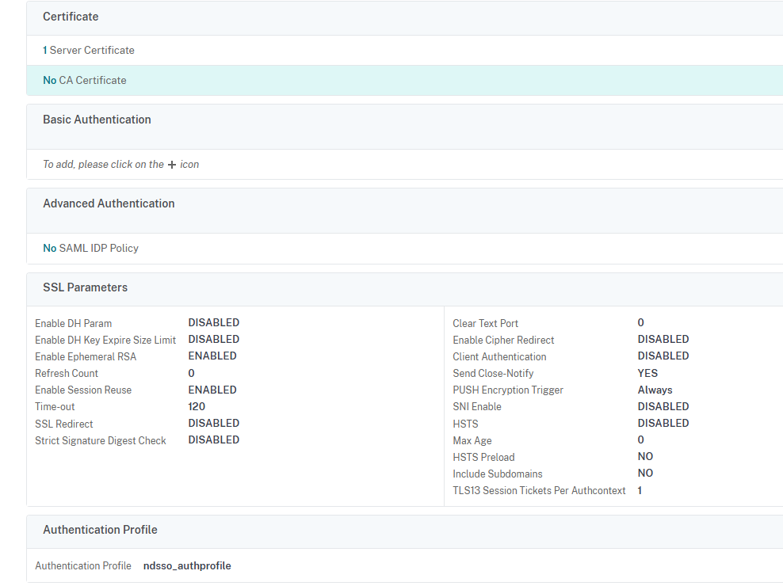
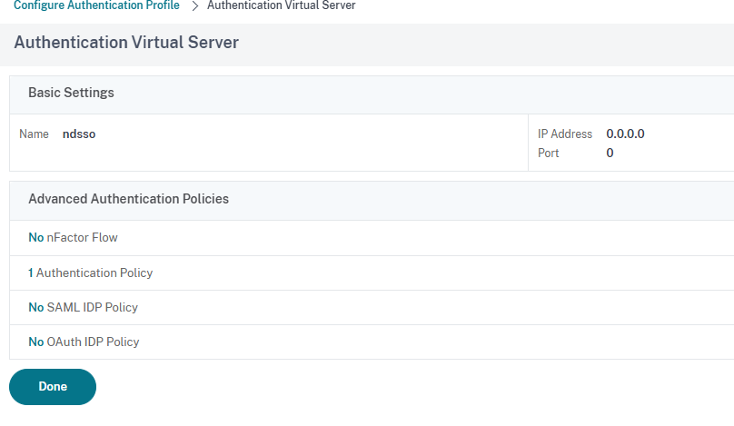
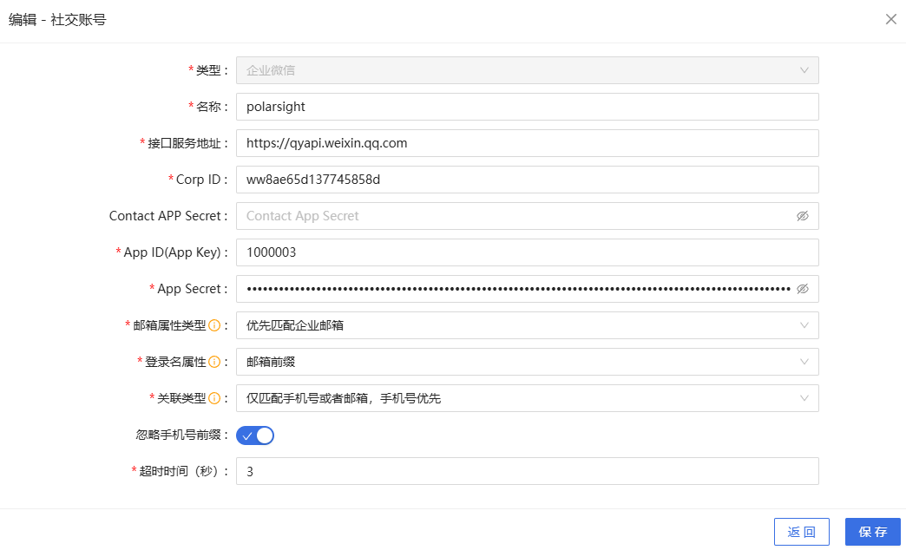

## 概述

本文记录以宁盾作为 SAML IdP、Citrix NetScaler（ADC）作为 SP 的 SSO 对接过程。重点是从宁盾自动生成的 IdP metadata 中提取并正确导入证书与各项 URL，避免在 NetScaler 侧出现签名校验失败或重定向错误。

## 一、在宁盾创建 SAML IdP 应用

在宁盾管理界面创建对应的 SAML 应用，配置完成后系统会自动生成 IdP metadata 信息。







> **证书复制的关键细节**：X.509 Certificate 文本框中的内容必须用 `Ctrl+A` 全选复制，不要用鼠标拖选。鼠标选择容易遗漏首尾字符或带入空白，导致导入 NetScaler 后证书无法识别。IdP metadata 的 XML 里也包含同一份证书，可作为交叉校验来源。

## 二、metadata 字段解析

从 IdP metadata 中可解析出以下字段，分别对应 NetScaler SAML IdP 配置的不同参数：

| metadata 字段 | 值 | NetScaler 对应参数 |
| --- | --- | --- |
| IdP Entity ID / Issuer | `http://nd.polarsight.com.cn:7080/f6db1f44-77e8-4d4f-a078-dd0d1a1be59a` | `samlIdpUrl` / Issuer |
| HTTP-POST SSO URL | `http://nd.polarsight.com.cn:7080/uc/service/idp/sso/front/sp/f6db1f44-77e8-4d4f-a078-dd0d1a1be59a` | `samlRedirectUrl` |
| HTTP-Redirect SSO URL | 同上 | `samlRedirectUrl` |
| NameID Format | `urn:oasis:names:tc:SAML:1.1:nameid-format:unspecified` | NameID 格式 |
| IdP Certificate | 见下方证书块 | `samlIdPCertName` |

用户访问 NetScaler 时，会被重定向到上表中的 SSO URL 去宁盾完成登录。

## 三、导入签名证书

在 NetScaler 上创建证书对象，名称为 `idp_polar_signing_key`，内容为宁盾导出的签名证书：

```text
-----BEGIN CERTIFICATE-----
MIIC3zCCAcegAwIBAgIFAJSwwcMwDQYJKoZIhvcNAQELBQAwMDEMMAoGA1UEAwwDU1NPMRAwDgYD
VQQLDAdQcm9kdWN0MQ4wDAYDVQQKDAVOREtFWTAgFw0yNjEwMTQwOTI4NTBaGA8yMDc2MTAwMTA5
Mjg1MFowMDEMMAoGA1UEAwwDU1NPMRAwDgYDVQQLDAdQcm9kdWN0MQ4wDAYDVQQKDAVOREtFWTCC
ASIwDQYJKoZIhvcNAQEBBQADggEPADCCAQoCggEBAKhk++Uxn19cv+ayQunIgvucRustL2f9RvAA
T2rko2uOu9n1SCKA4zQXp6mqU+IVEWqgTjn3+z3cEYFuoGoxaatKZnT3OJuwnk8VCvu+GXErOfUW
SKHWDAzilB8Yj5ZALb5n66woryezz8oCu0RV1QQ6CjACwhGwnZ8Qea12/nMbNICm8hAfIiIvxT69
WBvUxA1cAIejPcuNU+6ee/ztLsjvYcaDb9WpE0ciiKTEb/CMwGaneU9H832oxAXOdnOnDKKmEsYD
BaBMRsYFtc9zzzhVJJ/PgvUbug+ynWfvacuXySgKBvSonR0Al3v7O5dqWGJoqqe9Z8ILFdrF6VpW
n1kCAwEAATANBgkqhkiG9w0BAQsFAAOCAQEAoU1kFHxLGtxBkdu/QIN76QjNH6GfSf6eCT7jAOBK
Xs9krPQJM+1/+8+MO3z3KRDavD7zWPDKU3IFmtDIw1zSVlNNsOuKxpN2D5JRBtOtFYJXxujVcFy1
B39p9DMBmZPTH2jIwqjYuF96fMJyJ7kPudAc5dCDaI3qWggA/5XavEcoCGVZoXeAfQMxWI05cvGh
Q5iyiBIEeAlpCbk/XfHf3ZPttfOlJjhdnynhuD7SApokcds4czCkUh8hzAL3+ItFpdb1SDuVgfyE
2vOHHwBexxb0XRzfCGjRkKu5A2ME1YGQHifyKpyRKKFxMObEI1ncT/EzbVUFJkuyCNvx5lWbbg==
-----END CERTIFICATE-----
```

## 四、创建 SAML 认证策略

通过 NetScaler CLI 创建 SAML Action：

```bash
add authentication samlAction saml_action_polarsight \
  -samlIdPCertName idp_polar_signing_key \
  -samlRedirectUrl "http://nd.polarsight.com.cn:7080/uc/service/idp/sso/front/sp/f6db1f44-77e8-4d4f-a078-dd0d1a1be59a" \
  -samlUserField userPrincipalName \
  -samlIssuerName "https://" \
  -logoutURL "http://nd.polarsight.com.cn:7080/uc/api/signOn/signOffRedirect" \
  -samlBinding REDIRECT \
  -samlIdpUrl "http://nd.polarsight.com.cn:7080/f6db1f44-77e8-4d4f-a078-dd0d1a1be59a" \
  -rejectUnsignedAssertion OFF
```

参数说明：

- `samlUserField userPrincipalName`：指定用 Assertion 中的哪个属性作为登录用户名。
- `samlBinding REDIRECT`：认证请求通过 HTTP-Redirect 绑定发送。
- `rejectUnsignedAssertion OFF`：允许未签名的 Assertion（宁盾默认场景需要；如已启用签名，建议改为 ON 以提升安全性）。
- `logoutURL`：宁盾侧的单点登出地址。





## 五、Gateway 中配置

把认证策略绑定到对应的 Gateway 虚拟服务器，在「Authentication」→「SAML」中选择刚才创建的 `saml_action_polarsight`。







配置完成后效果如下：



## 六、排障要点

| 现象 | 检查点 |
| --- | --- |
| 证书导入后不识别 | 是否用 `Ctrl+A` 全选复制，证书首尾行是否完整 |
| Assertion 校验失败 | `samlIdPCertName` 是否绑定正确证书；证书是否过期 |
| 重定向到错误地址 | `samlRedirectUrl` 与 metadata 中的 SSO URL 是否一致 |
| 用户名映射为空 | `samlUserField` 与宁盾返回的 Assertion 属性是否匹配 |
| 单点登出无效 | `logoutURL` 是否正确，宁盾侧是否配置登出回调 |

---

> 本文由 WorkBuddy AI 编辑整理。
